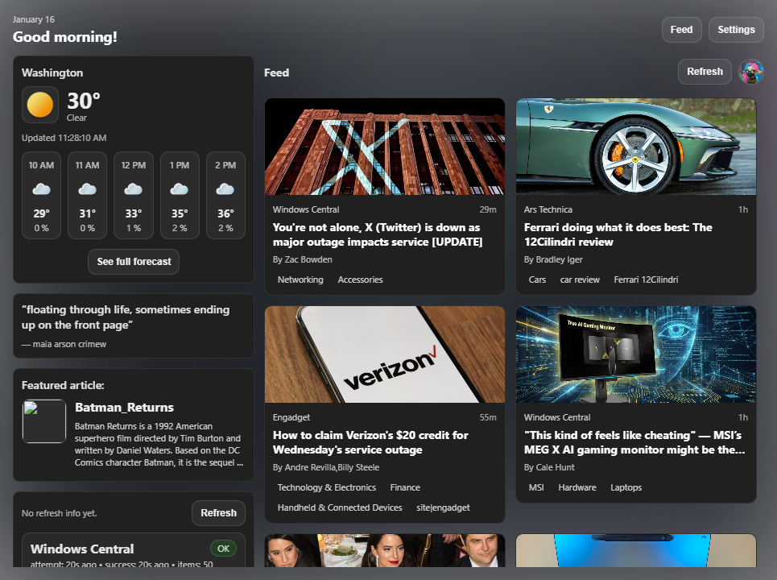

# OpenWidgets

OpenWidgets is a project to provide a partally inspired recreation of the Windows 11 Widgets panel in Python and HTML5. This project currently relies somewhat on Windows APIs but aims to be cross platform in the future.

## Widget development

Widget development section

### Human Interface Guidelines
Since this is trying to mimic the Windows 11 Widgets board, I strongly reccomend following Microsoft's official guidelines for widget design. These can be found at these links:
- [Fluent 2 (Microsoft Design)](
https://learn.microsoft.com/en-us/windows/apps/design/widgets/widgets-design-fundamentals)
- [Widget design fundamentals (Microsoft Learn)](
https://learn.microsoft.com/en-us/windows/apps/design/widgets/widgets-design-fundamentals)

### How do I write my widgets?

You can use 1 of 2 methods to write your widget.

#### Python and HTML

Similar to standard webdev, you can write your widget in HTML, CSS, and JavaScript. Right now you should assume a target of around Chromium 100-120.

#### Python and Adaptive Cards
>
> [!CAUTION]
> This feature does not exist yet but is planned for a future release.

>
> [!CAUTION]
> I do not understand how Adapative Cards work, I'm still learning what they are, so I'm sure I'm getting things wrong

Like with Windows 11's Widgets board, you will be able to write widgets that return an Adaptive Card and render that way. These widgets are planned to be more secure against XSS and other attacks, but do not support advanced scripting and such.

## Progress

Moved to progress.md as it got too long. 